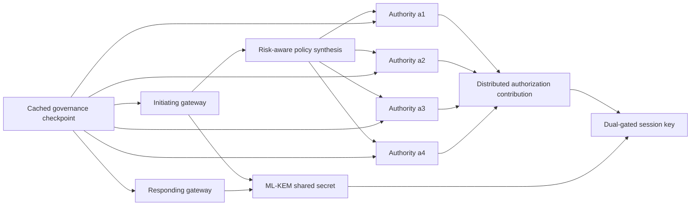

# ASTRA-PQ

Adaptive split-trust, risk-aware authorization and post-quantum session establishment for cross-domain Industrial Internet of Things systems.

ASTRA-PQ is a Rust research prototype that synthesizes an authorization structure for each session, obtains authenticated distributed authorization evidence from independently administered authorities, and combines that evidence with an ML-KEM shared secret to establish a gateway-to-gateway session key.

The repository includes the implementation, deployment artifacts, benchmark scripts, raw measurements, statistical summaries, and fail-closed evaluations used through release `adaptive-session-v0.8.0`.

## Architecture



The design separates three responsibilities:

1. **Authorization:** policy-selected authorities produce signed LWR partial evaluations.
2. **Session establishment:** the endpoint gateways establish an ML-KEM secret and derive the session key from both cryptographic gates.
3. **Governance:** gateways and authorities validate a signed, epoch-bound governance checkpoint outside the session-critical path.

The complete session key is not reconstructed by an authorization authority and is not exported by the evaluated gateway implementation.

## Implemented Components

The Rust workspace contains the following principal crates:

| Crate | Responsibility |
|---|---|
| `astra-common` | Canonical contexts, identifiers, risk classes, encodings, and hashes |
| `astra-synthesizer` | Deterministic risk-aware authorization-policy synthesis |
| `astra-dprf` | Exact-coalition LWR distributed PRF backend |
| `astra-authority` | Authority-side request validation and signed evidence |
| `astra-pqcrypto` | ML-KEM-768, ML-DSA-65, HKDF, and key confirmation |
| `astra-governance` | Signed governance-bundle and checkpoint validation |
| `astra-gateway` | Gateway authorization and evidence processing |
| `astra-testkit` | Services, clients, provisioners, experiments, and test utilities |

Important executables include:

- `astra-authority-service`
- `astra-distributed-client`
- `astra-session-client`
- `astra-session-responder`
- `lwr-provision`
- `astra-session-share-provision`
- `astra-authority-keys`
- `astra-gateway-keys`
- `astra-responder-kem-keys`
- `astra-governance-bundle`

## Cryptographic Profile

The evaluated profile uses:

- ML-KEM-768 for gateway key establishment.
- ML-DSA-65 for gateway requests and authority evidence.
- HKDF-based dual-gate session-key derivation.
- Role-separated bidirectional key-confirmation tags.
- An exact-coalition LWR DPRF with:
  - \(n=1024\)
  - \(q=2^{64}\)
  - \(q_1=2^{42}\)
  - \(p=2^{10}\)
  - 26 parallel instances
  - 256-bit output
- Canonical, session-bound, epoch-bound protocol encodings.
- Signed off-path governance bundles.
- Replay and duplicate session-clause rejection.

The LWR backend is an experimental static, semi-honest construction. See [Security Scope](#security-scope) before interpreting the results.

## Risk-Adaptive Policies

The validated adaptive profile supports five governed risk classes:

| Risk | Authorities | Clauses | Evidence items | Governed minimum |
|---|---:|---:|---:|---:|
| R0 | 1 | 1 | 1 | 1 |
| R1 | 2 | 2 | 3 | 2 |
| R2 | 2 | 3 | 4 | 2 |
| R3 | 3 | 4 | 6 | 3 |
| R4 | 4 | 5 | 8 | 4 |

R4 adds an independent human-confirmation authority and strengthens the risk-floor clause to four organizations. The responder independently synthesizes the expected policy and rejects a session if the supplied structure differs from the governed result.

## Experimental Environment

The distributed evaluation used eight AArch64 Ubuntu virtual machines:

- One controller.
- Two domain gateways.
- Five additional authority hosts.
- Two virtual CPUs per VM.
- Linux `6.8.0-138-generic`.
- An isolated private experiment network.
- A separate management network.
- Zero packet loss during the recorded 20-probe path checks.
- Mean private-network round-trip times between approximately 0.794 and 1.106 ms.

Rust compilation was performed on the controller. Identical release binaries were deployed to the remote VMs with Ansible and executed as systemd services.

## Selected Results

All values below are descriptive measurements from the committed raw datasets.

### LWR and Distributed Authorization

| Measurement | Result |
|---|---:|
| Single-VM LWR integration median | 6.068 ms |
| Single-VM LWR integration p95 | 6.975 ms |
| Exact-coalition \(t=1\) median | 0.673 ms |
| Exact-coalition \(t=7\) median | 2.684 ms |
| Persistent distributed \(t=1\) median | 0.900 ms |
| Persistent distributed \(t=7\) median | 2.650 ms |
| Cold distributed \(t=7\) median | 3.414 ms |
| Persistent \(t=7\) median reduction | 22.38% |

Each threshold configuration contains 100 samples.

### Dynamic Coalitions

The seven-authority profile enumerated:

- 127 nonempty exact coalitions.
- 448 provisioned authority-share files.
- Approximately 94 MiB of complete provisioning material.
- 64 applicable coalitions on each authority host.

For threshold three, the system completed 100 of 100 sessions in each controlled exclusion configuration:

| Excluded authorities | Selected coalition | Median authorization |
|---:|---|---:|
| 0 | `a1+a2+a3` | 2.380 ms |
| 1 | `a2+a3+a4` | 2.036 ms |
| 2 | `a3+a4+a5` | 2.088 ms |
| 3 | `a4+a5+a6` | 1.989 ms |
| 4 | `a5+a6+a7` | 1.938 ms |

A threshold-seven request failed closed when only six authorities were reachable.

### Distributed Dual-Gate Sessions

The validated R3 experiment completed 100 of 100 initiator sessions and 100 of 100 responder sessions. Initiator and responder session-identifier sets matched exactly.

| Measurement | Median | p95 | p99 |
|---|---:|---:|---:|
| Total session establishment | 13.304 ms | 15.782 ms | 15.913 ms |
| Authority collection | 2.286 ms | 3.207 ms | 4.816 ms |
| Responder handshake | 6.991 ms | 8.955 ms | 9.161 ms |
| Authority-request signing | 1.767 ms | 2.618 ms | 2.926 ms |
| Evidence verification | 0.398 ms | 0.434 ms | 0.441 ms |
| ML-KEM encapsulation | 0.012 ms | 0.023 ms | 0.023 ms |

The median signed gateway session request was 94,117 bytes.

### Risk-Adaptive Sessions

The balanced adaptive experiment contains 500 successful sessions, with 100 sessions per risk class and cyclically rotated experiment order.

| Risk | Total median | Total p95 | Total p99 | Median request size |
|---|---:|---:|---:|---:|
| R0 | 6.448 ms | 11.773 ms | 13.603 ms | 29,737 bytes |
| R1 | 11.457 ms | 14.778 ms | 15.700 ms | 55,466 bytes |
| R2 | 11.359 ms | 16.434 ms | 19.165 ms | 68,397 bytes |
| R3 | 13.560 ms | 16.470 ms | 16.913 ms | 94,143 bytes |
| R4 | 16.048 ms | 17.929 ms | 18.968 ms | 119,911 bytes |

All 500 sessions reported:

- Successful bidirectional key confirmation.
- No session-key export.
- Exact governed clause and evidence counts.
- Matching initiator and responder session identifiers.

## Fail-Closed Evaluation

Recorded negative tests include:

- Missing mandatory R3 authority.
- Missing R4 human-confirmation authority.
- Insufficient reachable authorities for threshold seven.
- Tampered governance predecessor link.
- Wrong responder ML-DSA verification key.
- Stale epochs.
- Duplicate session-clause requests.
- Unknown or duplicate authority identifiers.
- Corrupted provisioning material.
- Noncanonical coalition identifiers.
- Context and ciphertext changes.
- Signature and confirmation-tag tampering.

These tests validate the implemented rejection paths. They are not a substitute for a formal security proof.

## Building and Testing

Install a Rust toolchain compatible with edition 2024, then run:

```bash
cargo fmt --all -- --check

CARGO_BUILD_JOBS=2 cargo test \
  --workspace \
  --release

CARGO_BUILD_JOBS=2 cargo clippy \
  --workspace \
  --all-targets \
  -- \
  -D warnings
```

The `oqs` dependency is configured with vendored ML-KEM and ML-DSA support, so the initial build may take longer than subsequent builds.

## Benchmark Scripts

The repository includes reproducible experiment drivers:

```text
scripts/run-persistent-benchmark.sh
scripts/run-dynamic-coalition-benchmark.sh
scripts/run-distributed-session-benchmark.sh
scripts/run-adaptive-session-benchmark.sh
scripts/summarize-adaptive-session.jq
scripts/summarize-adaptive-responder.jq
```

The scripts assume that the required authority and responder services, public keys, private keys, shares, and governance bundle have already been provisioned on the experiment hosts.

Provisioning secrets must remain outside the Git repository.

## Results and Reproducibility

Raw measurements and derived summaries are stored under `results/`. The repository records:

- JSON Lines samples.
- JSON summaries.
- CSV comparison tables.
- Environment captures.
- Resource measurements.
- Deployment metadata.
- File and binary hashes.
- Fail-closed execution records.

No benchmark observations were removed as outliers. Most stable configurations contain 100 samples. The results do not include confidence intervals or independent repetitions of the complete VM deployment.

## Release History

| Tag | Scope |
|---|---|
| `core-v0.1.0` | Core split-trust implementation |
| `lwr-baseline-v0.2.0` | Validated 100-run LWR baseline |
| `lwr-scaling-v0.3.0` | Threshold scaling from one to seven |
| `distributed-baseline-v0.4.0` | Cold and persistent distributed authorization |
| `dynamic-coalition-v0.5.0` | Reachability-aware exact-coalition selection |
| `concurrent-authorities-v0.6.0` | Bounded concurrent authority services |
| `distributed-session-v0.7.0` | Complete dual-gate distributed sessions |
| `adaptive-session-v0.8.0` | Risk-adaptive R0–R4 policies and evaluation |

## Security Scope

This repository is a research prototype, not a production security product.

The validated implementation currently has the following limitations:

- The LWR DPRF assumes static, semi-honest corruption.
- ML-DSA signatures authenticate partial evidence but do not prove correct LWR evaluation.
- Maliciously robust distributed evaluation is not implemented.
- Proactive share refresh is not implemented.
- Epoch-specific reprovisioning is not equivalent to proactive refresh.
- The governance bundle uses synthetic IOTA observations.
- No live IOTA publication, quorum, finality, gas, or recovery measurements are claimed.
- The authority transport does not provide confidentiality.
- Replay state is held in memory and is not durable across process restarts.
- Exact coalitions provide no redundancy after a coalition has been selected.
- The experiments used one homogeneous VM deployment rather than production IIoT hardware.
- Saturation, energy, wide-area loss, and Byzantine-partial experiments remain future work.

Do not use the prototype to protect operational industrial equipment without a separate security review, malicious-secure distributed primitive, encrypted transport, durable replay state, key-management process, and safety assessment.

## Repository

GitHub: [Amanasrah78/Adaptive_Split_trust](https://github.com/Amanasrah78/Adaptive_Split_trust)

## License

The Rust workspace declares the Apache License 2.0. Add the corresponding `LICENSE` file to the repository before relying on GitHub license detection or distributing release packages.
